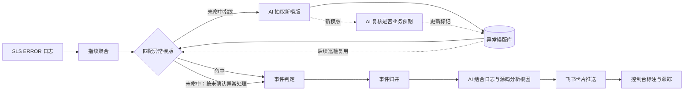

# ErrorAgent

ErrorAgent 是一个可独立部署的 AI 异常巡检服务：定时从阿里云日志服务（SLS）采集 ERROR 日志，完成指纹聚合、异常模版匹配、事件归并和大模型根因分析，并将结论推送到飞书群。

业务服务不需要接入 SDK，也不需要修改日志上报链路。

> 当前版本为 `v0.1`：面向单实例、Java 服务、阿里云 SLS 和飞书。它优先保证部署简单、链路可跑通，而不是一次覆盖所有日志源和通知渠道。

## 工作流程



这里有两类独立的 AI 任务：一类针对事件做根因分析；另一类把未命中的日志指纹抽象成可复用的异常模版。新模版入库后会立即回绑当前指纹，并在后续巡检中参与匹配和判定，形成“发现新异常 → 抽象模版 → 后续复用”的学习闭环。

核心能力：

- SLS 定时采集和服务端聚合，避免把全量日志拉回本地。
- 按异常类、业务栈帧、logger 和归一化消息生成稳定指纹。
- AI 从未命中指纹抽象新模版，持续补全模版库并在后续巡检中复用。
- 异常模版库、业务预期标注、首次出现与突增判定。
- 结合日志样本、同请求错误和 Java 源码片段进行 AI 根因分析。
- 飞书卡片首推、升级重推和同请求事件合并。
- 自带 Web 控制台，查看事件、模版、巡检记录和运行时配置。
- 发给大模型前默认脱敏手机号、身份证号、邮箱和常见密钥格式。

## 快速开始

### 方式一：Docker Compose

要求：Docker Engine 24+，Docker Compose v2。

```bash
cp .env.example .env
```

至少修改 `.env` 中这两个值：

```dotenv
MYSQL_PASSWORD=change-this-database-password
ERRORAGENT_ADMIN_PASSWORD=change-this-admin-password
```

启动：

```bash
docker compose up -d --build
```

打开 <http://localhost:8080>，使用 `ERRORAGENT_ADMIN_USERNAME` 和 `ERRORAGENT_ADMIN_PASSWORD` 登录。

首次启动默认只运行控制台，不采集日志，也不会调用大模型或飞书。确认基础服务正常后，再填写 `.env` 中的 SLS、LLM 和飞书配置，并将对应开关改为 `true`：

```dotenv
ERRORAGENT_ENABLED=true
LLM_ENABLED=true
PUSH_ENABLED=true
```

查看运行日志：

```bash
docker compose logs -f erroragent
```

停止服务：

```bash
docker compose down
```

MySQL 数据保存在 Docker volume 中；需要同时删除数据时请明确执行 `docker compose down -v`。

### 方式二：本地运行

要求：JDK 17、Maven 3.9+、MySQL 8、Git 2.31+。Node.js 会在 `mvn package` 时由 Maven 插件下载到项目目录，不要求全局安装。

1. 创建数据库并初始化表：

   ```bash
   mysql -u root -p -e 'CREATE DATABASE erroragent CHARACTER SET utf8mb4 COLLATE utf8mb4_unicode_ci;'
   mysql -u root -p erroragent < db/schema.sql
   ```

2. 配置环境变量：

   ```bash
   export ERRORAGENT_DB_URL='jdbc:mysql://localhost:3306/erroragent?useUnicode=true&characterEncoding=utf8&serverTimezone=Asia/Shanghai'
   export ERRORAGENT_DB_USERNAME='erroragent'
   export ERRORAGENT_DB_PASSWORD='your-database-password'
   export ERRORAGENT_ADMIN_PASSWORD='your-admin-password'
   ```

3. 构建并运行：

   ```bash
   mvn clean package
   java -jar target/erroragent-0.1.0-SNAPSHOT.jar
   ```

仅运行后端测试时可执行 `mvn test`；它不会重复构建前端。

前端本地开发：

```bash
cd web
npm ci
npm run dev
```

Vite 会把 `/inspect` 请求代理到 `http://localhost:8080`。

## 配置

所有部署配置都支持环境变量，完整示例见 [.env.example](.env.example)。主要配置如下：

| 环境变量 | 默认值 | 说明 |
|---|---:|---|
| `ERRORAGENT_ENABLED` | `false` | 采集和判定总开关 |
| `ERRORAGENT_ADMIN_USERNAME` | `admin` | 控制台管理员用户名 |
| `ERRORAGENT_ADMIN_PASSWORD` | 随机生成 | 控制台密码；生产环境必须显式设置 |
| `ERRORAGENT_APP_PACKAGES` | 空 | 业务 Java 包前缀，多个用逗号分隔 |
| `SLS_ENDPOINT` | 空 | SLS endpoint |
| `SLS_PROJECT` / `SLS_LOGSTORE` | 空 | SLS project 和 logstore |
| `SLS_ACCESS_KEY_ID` / `SLS_ACCESS_KEY_SECRET` | 空 | SLS 凭据，建议使用最小只读权限 |
| `LLM_ENABLED` | `false` | 是否启用 AI 分析 |
| `LLM_BASE_URL` / `LLM_API_KEY` / `LLM_MODEL` | 空 | OpenAI 兼容接口配置 |
| `LLM_REDACT` | `true` | 发给大模型前是否脱敏 |
| `PUSH_ENABLED` | `false` | 是否启用飞书推送 |
| `FEISHU_APP_ID` / `FEISHU_APP_SECRET` / `FEISHU_CHAT_ID` | 空 | 飞书应用和目标群配置 |
| `GIT_BASE_URL` / `GIT_TOKEN` | 空 | 用于源码定位的 Git 服务和只读凭据 |

采集周期、突增阈值、AI 限流和推送级别等运行时参数可在控制台“配置”面板修改，约 30 秒内生效。

### SLS 日志字段

v0.1 要求 logstore 使用以下字段名：

| 字段 | 必需 | 用途 |
|---|---|---|
| `log_level` | 是 | 只采集值为 `ERROR` 的日志 |
| `app_id` | 是 | 服务名 |
| `logger_class` | 是 | logger 名；无堆栈时参与指纹 |
| `message` | 是 | 日志正文和异常堆栈 |
| `_container_name_` | 否 | 按容器名前缀过滤 |
| `_pod_name_` | 否 | 实例名 |
| `trace_id` | 否 | 合并同一请求产生的多个异常 |

## 安全建议

- ErrorAgent 会读取原始错误日志，其中可能包含敏感数据；请限制数据库、控制台和备份的访问范围。
- 为 SLS、Git 和飞书使用专用、最小权限凭据，不要将 `.env` 提交到 Git。
- `LLM_REDACT=true` 只能降低常见信息泄露风险，不能替代业务侧的数据分类和审计。
- 控制台使用单管理员 HTTP Basic 认证，生产环境应放在 HTTPS 反向代理或受控内网之后。
- 安全问题请按 [SECURITY.md](SECURITY.md) 私下报告，不要在公开 Issue 中附带日志或密钥。

## 当前限制

- 只支持单实例运行，没有分布式锁。
- 日志源仅支持阿里云 SLS，代码定位仅支持 Java。
- 通知渠道仅支持飞书。
- Vue 2 和 Element UI 已停止维护，计划在后续版本迁移。
- 指纹包含代码行号，发版后行号变化可能产生新指纹。
- 统计、样本和大模型用量流水暂不自动清理。
- 登录用户拥有全部管理能力，没有细粒度权限。

更完整的实现说明见 [docs/design.md](docs/design.md)。

## 参与贡献

欢迎提交 Issue 和 Pull Request。开始前请阅读 [CONTRIBUTING.md](CONTRIBUTING.md)。

## License

[Apache License 2.0](LICENSE)
