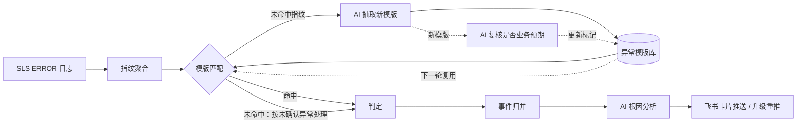

# erroragent v0.1 设计

> 状态：v0.1 已实现。更新日期：2026-10-19

## 1. 定位

erroragent 是一个独立部署的 AI 异常巡检服务。业务应用不需要接入 SDK：erroragent 定时从日志平台拉取 ERROR 日志，按指纹和异常模版去重、归并成事件，由大模型结合日志样本和源码分析根因，再把结论推送到 IM 群。



根因分析与模版抽取是两类独立的大模型调用。未命中指纹会在本轮采集末尾批量抽象为新模版，入库后回绑当前指纹，后续巡检再从模版库匹配，从而形成持续学习闭环。

v0.1 的目标是**能部署、能跑通**：沿用一套已在实际环境运行过的实现，去掉与特定业务的耦合，不追求完整的扩展性。

## 2. 范围

### 2.1 包含

| 环节 | 做法 | 主要类 |
|---|---|---|
| 采集 | 默认每 5 分钟用 SLS SQL 聚合 ERROR 日志，按 5 分钟桶写入统计；指纹在 SLS 侧计算：有堆栈时取「服务 + 异常类 + 业务栈帧」，无堆栈时取「服务 + logger + 归一化消息」 | InspectCollectJob、InspectCollectService、InspectSqlBuilder、InspectSlsRepository |
| 模版 | 用正则模版库匹配指纹；未命中的由 AI 批量抽取模版；AI 复核模版是否属于业务预期，只在高置信度时自动标记；抽取不出时生成兜底模版 | TemplateMatcher、TemplateExtractor、TemplateReviewService、TemplateFallbackService、LogKeyText、TechnicalFaultRule |
| 判定 | 没有模版或模版未标业务预期 → NEW；已标业务预期但量级超过基线倍数 → SURGE（默认关闭） | InspectJudgeService、SlsBaselineService |
| 事件 | 按模版归并，代码缺陷类再按服务和栈帧拆分；静默超过阈值自动关闭 | InspectEventService、InspectLibraryService |
| 分析 | 每个事件单轮调用大模型，输入指纹、判定结果、日志样本、同一请求的其他 ERROR、源码片段，输出结构化的根因结论 | InspectAnalyzeJob、InspectAnalyzeService、AnalysisPromptBuilder、AnalysisResponseParser、LlmClient |
| 代码定位 | 从堆栈或 logger 名定位到 Java 源码方法；仓库通过 git 同步到本地 | CodeLocator、StackFrameParser、JavaSourceIndex、JavaMethodExtractor、GitSyncService、GitCommandRunner |
| 推送 | 飞书应用机器人发送卡片；同一请求触发的多个事件合并成一张；未处理的事件按 1/2/4/8/24 小时升级重推；页面标注后更新原卡片 | InspectPushJob、InspectEventPushService、InspectCardBuilder、SameRequestMerger、FeishuApiClient |
| 管理页面 | 事件、异常模版库、巡检记录、配置四个页面 | 前端 Inspect* 组件 |

### 2.2 不包含

| 功能 | 原因 |
|---|---|
| 调用链分析 | 依赖特定云厂商的链路存储 |
| 影响面分析 | 统计维度和具体业务强相关；由大模型生成的正则会拼进查询 |
| 发版关联 | 依赖特定的容器镜像字段约定 |
| 指纹级反馈、抑制规则、表白名单 | 没有页面或代码在使用 |
| 卡片回调按钮、旧版指纹卡片 | 没有代码在使用，已被事件卡片取代 |
| 多实例部署 | v0.1 只支持单实例 |

### 2.3 后续版本

其他日志源（Loki、Elasticsearch、本地文件）、其他通知渠道（钉钉、企业微信、Slack、Webhook）、非 Java 代码定位、调用链与影响面分析、历史数据定期清理、接口权限分级、多实例部署。

## 3. 技术选型

| 项 | 选择 |
|---|---|
| JDK | 17 |
| 框架 | Spring Boot 4.1.x |
| ORM | MyBatis（mybatis-spring-boot-starter 4.1.x），XML 映射 |
| 数据库 | MySQL 8；表结构在 `db/schema.sql`，应用启动时不自动建表 |
| 日志源 | 阿里云 SLS Java SDK |
| 大模型 | OpenAI 兼容协议，通过 langchain4j-open-ai 调用；先沿用现有版本，与 Spring Boot 4 依赖冲突时再升级到 1.x |
| JSON | fastjson 1.2.83，v0.1 不替换 |
| 本地缓存 | Caffeine，模版和动态配置缓存 30 秒 |
| 源码解析 | JavaParser |
| 鉴权 | Spring Security HTTP Basic，单个管理员账号 |
| 调度 | Spring `@Scheduled`，调度线程池大小 4 |
| 前端 | Vue 2 + Element UI + ECharts，构建产物打包进 jar |
| 部署 | 单个 jar 或 Docker 镜像；docker-compose 附带 MySQL |

不依赖 Redis 和配置中心。

## 4. 工程结构

```
erroragent/
├── pom.xml
├── db/schema.sql
├── Dockerfile
├── compose.yaml
├── docs/
├── web/                         前端
└── src/main/java/io/github/liufor02144/erroragent/
    ├── ErrorAgentApplication.java
    ├── common/                  统一返回体、全局异常处理、安全配置
    ├── config/                  配置属性、开关
    ├── controller/
    ├── dto/  entity/  mapper/
    ├── job/
    └── service/                 analyze、code、collect、judge、push、query、run、template
```

类名沿用现有的 `Inspect` 前缀，表名沿用 `ai_inspect_` 前缀，减少迁移改动。

## 5. 配置

### 5.1 部署配置

写在 `application.yml` 或环境变量里，重启生效。三个开关默认关闭，全部关闭时服务只启动不巡检。

```yaml
erroragent:
  enabled: false                  # 采集、判定总开关
  admin:
    username: admin
    password: ${ERRORAGENT_ADMIN_PASSWORD}
  naming:
    app-packages: com.example     # 业务代码包前缀，逗号分隔；用于识别业务栈帧和定位源码。不配时有堆栈的异常也只能按 logger 与消息模版聚合
    strip-prefixes: ""            # 展示服务名时去掉的前缀，逗号分隔
  sls:
    endpoint: cn-hangzhou.log.aliyuncs.com
    project: your-project
    logstore: your-logstore
    access-key-id: ${SLS_ACCESS_KEY_ID}
    access-key-secret: ${SLS_ACCESS_KEY_SECRET}
    container-prefix: ""          # 只采集容器名以此开头的日志，为空表示不限
    extra-app-ids: ""             # 前缀之外额外采集的 app_id，逗号分隔
  llm:
    enabled: false
    base-url: https://api.example.com/v1
    api-key: ${LLM_API_KEY}
    model: your-model
    redact: true                  # 发给大模型前脱敏
  push:
    enabled: false
    app-id: ${FEISHU_APP_ID}
    app-secret: ${FEISHU_APP_SECRET}
    chat-id: oc_xxx
    detail-base-url: http://localhost:8080   # 卡片上「去标注」按钮的跳转地址
  git:
    base-url: https://git.example.com
    username: oauth2              # HTTP 认证用户名：GitLab 用 oauth2，GitHub 用 x-access-token
    token: ${GIT_TOKEN}
    local-path: ./data/repos
    sync-cron: "0 0 3 * * ?"
    sync-timeout-seconds: 300
```

### 5.2 运行时调优

存在 `ai_inspect_config` 表里，在配置页修改，30 秒内生效。常用项：

| 键 | 默认值 | 含义 |
|---|---|---|
| collect.scan.interval.seconds | 300 | 采集周期 |
| judge.surge.enabled | false | 是否对已标业务预期的异常做突增判定 |
| judge.surge.multiple / judge.surge.min.count | 3 / 10 | 突增倍数、最小次数 |
| judge.baseline.days | 7 | 基线回看天数 |
| event.close.quiet.hours | 6 | 事件静默多久自动关闭 |
| event.repush.enabled / event.repush.hours | true / 1,2,4,8,24 | 升级重推开关与间隔 |
| event.ai.interval.hours / event.ai.reanalyze.growth | 1 / 3 | 同一事件重新分析的最短间隔、量级增长倍数 |
| push.severity.include | P0,P1,P2 | 推送哪些级别 |
| push.daily.limit / push.max.per.round | 10 / 5 | 每日首推上限、单轮推送上限 |
| llm.daily.limit / llm.rpm.limit / llm.timeout.seconds | 100 / 3 / 180 | 大模型每日调用上限、每分钟调用上限、超时 |
| template.extract.batch.size / template.extract.max.per.round | 15 / 60 | 模版抽取每批数量、单轮上限 |
| run.retain.days | 7 | 巡检记录保留天数 |

## 6. 日志格式要求

v0.1 不做字段映射，SLS logstore 需要有以下字段：

| 字段 | 用途 | 必需 |
|---|---|---|
| `log_level` | 只采集值为 `ERROR` 的日志 | 是 |
| `app_id` | 服务名 | 是 |
| `logger_class` | logger 名，无堆栈时参与指纹 | 是 |
| `message` | 日志正文，含堆栈 | 是 |
| `_container_name_` | 按 `container-prefix` 过滤采集范围；没有这个字段时用 `extra-app-ids` 指定服务 | 否 |
| `_pod_name_` | 实例名 | 否 |
| `trace_id` | 同一请求的事件合并、取同请求的其他日志 | 否 |

## 7. 数据表

| 表 | 用途 |
|---|---|
| ai_inspect_config | 运行时调优配置 |
| ai_inspect_fingerprint | 指纹 |
| ai_inspect_stat | 指纹 × 5 分钟桶的计数，用于基线 |
| ai_inspect_sample | 日志样本 |
| ai_inspect_library | 异常模版库 |
| ai_inspect_event | 事件及推送状态 |
| ai_inspect_analysis | AI 分析结论 |
| ai_inspect_llm_usage | 大模型调用流水，用于每日上限和费用统计 |
| ai_inspect_run / ai_inspect_run_item | 巡检轮次及明细 |
| ai_inspect_project | 代码仓库与服务的对应关系 |

## 8. 定时任务

| 任务 | 频率 |
|---|---|
| 采集 | 每 60 秒检查一次，按 `collect.scan.interval.seconds` 执行 |
| 分析 | 每 120 秒，每轮最多 20 个事件 |
| 推送 | 每 120 秒 |
| 代码同步 | 启动后一次，之后按 `git.sync-cron` |

单实例部署下，同一任务不会重叠执行（`fixedDelay`），不需要分布式锁；采集周期用内存中的上次执行时间判断。

## 9. 相对原实现的改动

### 9.1 部署形态

- 去掉 Redis 锁，只支持单实例。
- 去掉配置中心，部署配置改为 `application.yml` 和环境变量。
- 登录改为 HTTP Basic；页面上记录的操作人取当前登录用户名。
- 统一返回体保持原有字段结构，前端不需要改接口处理。

### 9.2 去除特定业务内容

- 包名改为 `io.github.liufor02144.erroragent`，配置前缀改为 `erroragent`。
- 代码中写死的业务包前缀、容器名前缀、链路存储地址，改为配置或随功能删除。
- 提示词和规则中的业务示例换成通用示例。
- 测试和注释中的真实日志样本换成编造的数据。

### 9.3 修复

| 问题 | 修复后的行为 |
|---|---|
| 一轮采集中如果全部是新指纹，会被当作冷启动，整轮不产生事件；流量小的系统里新异常会被吞掉 | 只有指纹表为空（首次部署）时才按冷启动处理 |
| 拼接 SLS 查询时没有转义 | SQL 字符串里的值把单引号写两遍；检索语句双引号短语里的值去掉双引号和反斜杠；业务包前缀只接受字母、数字、下划线和点 |
| git token 拼在 clone 地址里，出现在进程参数中；先读完输出再等进程结束，超时不生效，stdout 和 stderr 串行读取可能死锁；本地目录名只取仓库路径最后一段，可能重名或越出目录 | token 通过 `GIT_CONFIG_*` 环境变量注入 `http.extraHeader`，不进进程参数（需要 git 2.31+）；输出重定向到临时文件，超时后强制结束进程；本地目录名由完整仓库路径转换得到，并校验在 `local-path` 之内；分支名不允许以 `-` 开头 |
| 所有定时任务共用一个线程，采集和分析互相阻塞 | 调度线程池大小设为 4 |
| 原始日志不脱敏直接发给大模型 | `llm.redact=true`（默认）时，发给大模型的用户消息先用正则替换手机号、身份证号、邮箱和常见密钥格式；样本入库仍是原文 |

## 10. 已知问题

v0.1 不修，记录在 README：

- 兜底模版在 AI 抽取之前写入，稳定运行后 AI 抽取很少被触发。
- 指纹包含代码行号，发版后行号变化会产生新指纹，和历史统计接不上。
- 大模型每日上限只限制分析，模版抽取和复核不受限制。
- 每日首推上限统计偏松。
- 统计、样本、大模型流水数据只增不删。
- 接口不区分权限，登录用户都能修改配置和强制推送。

## 11. 验收标准

1. `mvn test` 全部通过。迁移过来的单测保留，被删功能对应的用例一并删除。
2. 代码、配置、测试、文档里不含原业务的包名、域名、服务名和业务名词；gitleaks 扫描无告警。
3. 用 docker-compose 启动 MySQL 和 erroragent，配好 SLS、大模型和飞书后，能完成一轮「采集 → 事件 → 分析 → 推送」，在页面上能看到事件并完成标注。
4. 不配大模型和飞书时，服务能正常启动，只做采集和判定。
